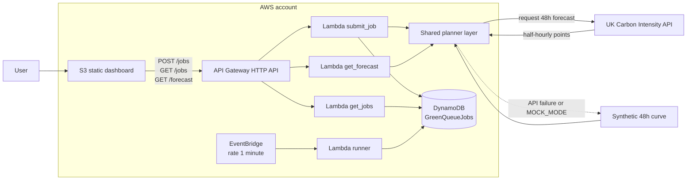

# GreenQueue

Carbon-aware batch scheduling on AWS serverless. Submit a job and a deadline;
GreenQueue reads 48 hours of UK grid carbon intensity and runs the job in the
cleanest half-hour window that still meets the deadline. It reports the CO₂
avoided compared with starting immediately.

Built for a university cloud-computing hackathon. Everything deploys from one
SAM template, has no paid data dependency, and fits comfortably in the AWS free
tier at demo volume.

```text
submit a job ──▶ scan 96 half-hour slots ──▶ pick the cleanest feasible window
                                                         │
                       dashboard ◀── DynamoDB ◀── EventBridge wakes the runner
```

## What is included

- **One-command deployment.** `./deploy.sh` builds, deploys, seeds, and publishes.
- **48-hour forecast.** Live UK Carbon Intensity API with an automatic synthetic
  fallback, plus an explicit `MOCK_MODE` switch for stage safety.
- **Carbon-aware planner.** Finds the minimum-average feasible window and
  computes CO₂ avoided at 100 W per job-hour.
- **Real queue behaviour.** EventBridge ticks every minute; due jobs transition
  `QUEUED → RUNNING → COMPLETED` with conditional writes.
- **Production-shaped dashboard.** Single static `index.html`, Chart.js from a
  CDN, live status badges, auto-refresh, animated counters, and markers for each
  scheduled job.
- **Interactive preview mode.** If the API is unreachable or the API URL has not
  been injected, the page generates a realistic forecast and demo queue locally
  so the UI can still be demonstrated.
- **Least-privilege IAM.** Each function receives only the DynamoDB actions it
  needs.

## Architecture



Request path:

1. The dashboard calls `GET /forecast` and `GET /jobs`.
2. A submission calls `POST /jobs`; `submit_job` validates it, invokes the shared
   planner, and writes a `QUEUED` job with its scheduled window and CO₂ estimate.
3. Every minute, EventBridge invokes `runner`. It scans for due jobs, flips
   `QUEUED` to `RUNNING`, and completes `RUNNING` jobs on the next tick,
   simulating execution. Each transition is guarded by a DynamoDB condition.
4. The dashboard polls `GET /jobs` every 20 seconds and refreshes the forecast
   every ten minutes.

## Quick start

### Prerequisites

- An AWS account. Your principal needs permissions to create CloudFormation
  stacks, IAM roles, Lambda functions and layers, API Gateway HTTP APIs,
  DynamoDB tables, EventBridge rules, S3 buckets and bucket policies, and
  CloudWatch log groups. `AdministratorAccess` is the simplest hackathon
  choice; scope it down for anything real.
- **AWS CLI v2**, configured: `aws configure` and then check with
  `aws sts get-caller-identity`.
- **AWS SAM CLI** (tested with 1.172.1) and **Python 3.10+**.
- Bash. On Windows, use Git Bash or WSL. Docker is not required.
- No carbon API key is needed.

### Deploy

```bash
git clone https://github.com/ArjunD717/GreenQueue.git
cd GreenQueue
./deploy.sh
```

The script:

1. verifies AWS credentials and tooling,
2. runs `sam build` and a non-interactive `sam deploy`,
3. reads the stack outputs,
4. injects the API URL into a built copy of `dashboard/index.html`,
5. syncs the page to the website bucket,
6. seeds 15 realistic jobs, and
7. prints the dashboard and API URLs.

For live carbon data:

```bash
MOCK_MODE=false ./deploy.sh
```

Useful overrides:

```bash
STACK_NAME=greenqueue-live AWS_REGION=eu-west-2 MOCK_MODE=false ./deploy.sh
SKIP_SEED=true ./deploy.sh
ALLOWED_ORIGIN="http://my-bucket.s3-website.eu-west-2.amazonaws.com" ./deploy.sh
```

`MOCK_MODE=true` is the default so the on-stage demo can never depend on a
third-party API. With `MOCK_MODE=false`, a live API failure still falls back to
the synthetic curve automatically.

### Tear down

```bash
sam delete --stack-name greenqueue --region eu-west-2
```

If SAM refuses to delete the non-empty website bucket, empty it first:

```bash
aws s3 rm s3://<WebsiteBucketName-from-outputs> --recursive
sam delete --stack-name greenqueue --region eu-west-2
```

## File tree

```text
GreenQueue/
├── deploy.sh                   # build → deploy → inject → sync → seed → print URLs
├── seed.py                     # 15 idempotent demo jobs (boto3, AWS CLI fallback)
├── template.yaml               # full SAM stack
├── test_planner.py             # planner unit tests (run locally, no AWS)
├── dashboard/
│   └── index.html              # complete dashboard, no build step
├── src/
│   ├── planner_layer/
│   │   ├── planner.py          # forecast, window search, CO₂ math
│   │   └── common.py           # UTC helpers, JSON/CORS responses
│   ├── submit_job/app.py       # POST /jobs
│   ├── get_jobs/app.py         # GET /jobs
│   ├── get_forecast/app.py     # GET /forecast
│   └── runner/app.py           # EventBridge tick
├── README.md
└── DEMO.md                     # pitch, 2-minute script, scaling math, next steps
```

## How the planner works

1. Fetch the next 96 half-hour points from
   `https://api.carbonintensity.org.uk/intensity/{from}/fw48h`
   (the API's documented forward-window path).
2. Drop points that begin before now.
3. Validate the job: duration is 0.5–24 hours in 30-minute steps; the deadline
   must be in the future and at least one full job-length away.
4. For every candidate start, take the mean intensity of the job's slots. Keep
   the lowest-mean window whose end is on or before the deadline. Ties go to the
   earliest window.
5. Convert grid intensity to CO₂:

   ```text
   energy_kWh   = duration_hours × 100 W ÷ 1000
   co2_grams    = mean_intensity_gCO₂_per_kWh × energy_kWh
   co2_saved    = max(0, co2_if_started_now − co2_scheduled)
   reduction_%  = co2_saved ÷ co2_if_started_now × 100
   ```

   The "started now" baseline is the first full job-length window in the
   forecast, not historical generation. This is conservative and keeps the
   comparison like-for-like.
6. Store the chosen start/end, average intensity, baseline, scheduled CO₂, CO₂
   saved, and reduction percentage with the job.

The synthetic curve uses a deterministic daily shape: an evening peak around
19:00 UTC, an overnight dip around 03:00 UTC, and a smaller midday solar dip.
The shape is illustrative, not a forecast for a specific date.

Time handling: all data and the API use UTC ISO-8601. The dashboard renders
times in the viewer's local timezone and submits deadlines as ISO timestamps.
The deadline may be more than 48 hours away, but the scheduler can only search
inside the 48-hour forecast horizon.

## API

Base URL is printed by `deploy.sh` and stored in the `ApiUrl` stack output.

| Method | Path        | Purpose | DynamoDB access |
| ------ | ----------- | ------- | --------------- |
| `POST` | `/jobs`     | Validate, schedule, and store a job | `PutItem` |
| `GET`  | `/jobs`     | List jobs, newest submission first | `Scan` |
| `GET`  | `/forecast` | Return 48h forecast and source | None |

### Submit

```bash
API_URL="https://abc123.execute-api.eu-west-2.amazonaws.com"

curl -sS -X POST "$API_URL/jobs" \
  -H "Content-Type: application/json" \
  -d '{
    "name": "Nightly revenue rebuild",
    "duration": 4,
    "deadline": "2026-11-12T09:00:00Z"
  }'
```

`201 Created`:

```json
{
  "job": {
    "job_id": "job-7f9a2c4d10",
    "name": "Nightly revenue rebuild",
    "duration": 4,
    "deadline": "2026-11-12T09:00:00Z",
    "scheduled_start": "2026-11-12T03:00:00Z",
    "scheduled_end": "2026-11-12T07:00:00Z",
    "status": "QUEUED",
    "avg_intensity": 112.5,
    "immediate_intensity": 286.0,
    "energy_kwh": 0.4,
    "co2_now": 114.4,
    "co2_scheduled": 45.0,
    "co2_saved": 69.4,
    "reduction_pct": 60.7,
    "forecast_source": "mock",
    "created_at": "2026-11-11T12:00:00Z",
    "updated_at": "2026-11-11T12:00:00Z"
  }
}
```

Validation failures return `400` with a field map:

```json
{
  "error": {
    "code": "VALIDATION_ERROR",
    "message": "Check the highlighted fields.",
    "fields": {
      "deadline": "The deadline is too soon for this job to finish."
    }
  }
}
```

No feasible window returns `422 UNSCHEDULABLE`. Storage failures return `500`.
Bodies are limited to 16 KiB.

### Read

```bash
curl -sS "$API_URL/jobs" | jq '.count, .jobs[0]'
curl -sS "$API_URL/forecast" | jq '.source, .points[0:3]'
```

## Data model

Table: `GreenQueueJobs` (pay-per-request, partition key `job_id`).

| Attribute | Type | Notes |
| --------- | ---- | ----- |
| `job_id` | string | Deterministic primary key; `seed-xx` for demo rows |
| `name` | string | 1–80 characters, whitespace-normalized |
| `duration` | number | Hours, 0.5–24 in 0.5 steps |
| `deadline` | string | UTC ISO-8601 |
| `scheduled_start` / `scheduled_end` | string | Chosen window |
| `status` | string | `QUEUED`, `RUNNING`, `COMPLETED` |
| `avg_intensity` | number | Window mean, gCO₂/kWh |
| `immediate_intensity` | number | Baseline mean, gCO₂/kWh |
| `energy_kwh` | number | Duration × 0.1 kWh |
| `co2_now` / `co2_scheduled` / `co2_saved` | number | Grams |
| `reduction_pct` | number | Percentage less than immediate |
| `forecast_source` | string | `live`, `mock`, or seed marker |
| `created_at`, `updated_at` | string | UTC ISO-8601 |
| `started_at`, `completed_at` | string | Added by the runner |
| `actual_co2` | number | Simulated actual, set on completion |

The runner uses `ConditionExpression` on the current status so two overlapping
ticks cannot start or complete the same job twice.

## Dashboard

`dashboard/index.html` is the whole front end. There is no bundler and no
framework. Chart.js is the only runtime library.

- Dark "grid dispatch" visual system: Newsreader display type, Bricolage
  Grotesque UI type, deep spruce ground, ice-blue interaction accent. Carbon
  data uses a separate green → amber → red scale.
- The signature hero panel shows the cleanest 4-hour window and a 24-hour
  intensity strip built from the same forecast as the chart.
- The 48-hour chart has a segment-coloured line, an intensity-mapped gradient
  fill, a "now" rule, and a marker plus tooltip for every job scheduled inside
  the forecast window.
- Headline counters: total CO₂ saved in kg, jobs scheduled, average reduction.
- The job table is sorted active-first and auto-refreshes every 20 seconds. It
  becomes stacked cards on narrow screens.
- The form validates inline, announces errors, prevents duplicate submits, and
  replaces itself with a success panel after scheduling.
- If the API URL is still the placeholder, or the API fetch fails, the page
  enters preview mode with a synthetic forecast and 15 demo jobs. Preview
  submissions work locally and are not persisted. This is deliberate stage
  insurance and is labelled in the UI.
- Respects `prefers-reduced-motion`, keeps a visible keyboard focus ring, uses
  tabular figures to prevent counter jitter, and reserves space for inline
  errors.

To preview locally without AWS:

```bash
python -m http.server 8000 --directory dashboard
# open http://127.0.0.1:8000
```

The page will show "Preview data" because the API placeholder has not been
replaced.

## Seed data

```bash
python seed.py --table GreenQueueJobs --region eu-west-2
```

This writes 15 deterministic IDs (`seed-01` … `seed-15`): 11 completed jobs,
one running job, and three queued jobs. Re-running overwrites the same IDs, so
it is safe to reseed. The script uses boto3 if available; otherwise it shells
out to `aws dynamodb batch-write-item`. A running seed job will complete on the
next runner tick; that is expected.

## Configuration

### SAM parameters

| Parameter | Default | Description |
| --------- | ------- | ----------- |
| `MockMode` | `"true"` | Force the synthetic forecast. `"false"` uses the live API and falls back on failure. |
| `AllowedOrigin` | `"*"` | CORS origin. Set to the website origin for a tighter demo. |

### `deploy.sh` environment variables

| Variable | Default | Description |
| -------- | ------- | ----------- |
| `STACK_NAME` | `greenqueue` | CloudFormation stack name |
| `AWS_REGION` (or `AWS_DEFAULT_REGION`) | `eu-west-2` | Deployment region |
| `MOCK_MODE` | `true` | Forwarded to the `MockMode` parameter |
| `ALLOWED_ORIGIN` | `*` | Forwarded to the `AllowedOrigin` parameter |
| `SKIP_SEED` | `false` | Skip demo seeding |
| `PYTHON_BIN` | auto-detected | Python executable used by deploy and seed |

The `MOCK_MODE` environment variable inside Lambda is truthy only for
`true`, `1`, `yes`, or `on` (case-insensitive). Anything else uses the live API.

## Local checks

```bash
# Planner unit tests: valid window, deadline, global minimum, fallback
python test_planner.py -v

# Every Lambda compiles
python -m py_compile src/planner_layer/*.py src/submit_job/app.py \
  src/get_jobs/app.py src/get_forecast/app.py src/runner/app.py

# SAM template validation and build
sam validate --lint
sam build

# JavaScript syntax check for the single-file dashboard (requires Node)
python - <<'PY'
import re, pathlib
html = pathlib.Path("dashboard/index.html").read_text()
for i, script in enumerate(re.findall(r"<script(?![^>]*src=)[^>]*>(.*?)</script>", html, re.S)):
    pathlib.Path(f".check-{i}.js").write_text(script)
PY
node --check .check-0.js && node --check .check-1.js
rm -f .check-*.js
```

## Cost estimate

Demo assumptions: one presenter with the dashboard open for about 8 hours a
day, 20-second job polling, one job submitted per demo, and the one-minute
EventBridge tick running continuously.

| Service | Approximate monthly demo use | Free-tier position | Cost |
| ------- | ---------------------------- | ------------------ | ---- |
| Lambda | ~90k invocations; <5,000 GB-s | 1M requests + 400,000 GB-s every month | $0.00 |
| API Gateway HTTP API | ~130k requests | 1M/month (free-tier period) | $0.00 |
| EventBridge | 43,200 scheduled ticks | Low volume | under $0.10 |
| DynamoDB on-demand | 15 rows, a few writes per tick | 25 GB storage + free capacity | $0.00 |
| S3 website + policy | under 1 MB | 5 GB + requests free-tier period | $0.00 |
| CloudWatch Logs | a few MB | 5 GB/month | $0.00 |
| **Total** | | | **≈ $0.00; well under $1/month** |

There is no NAT Gateway, VPC, database server, or always-on compute. After the
12-month API Gateway/S3 free tiers expire, ordinary demo volumes are still
cents per month. Confirm current pricing for your account and region.

The forecast API is free and unauthenticated. It requires outbound HTTPS from
Lambda, which the default (non-VPC) configuration provides.

## Troubleshooting

| Symptom | Cause and fix |
| ------- | ------------- |
| `sam: command not found` or `aws: command not found` | Install the AWS SAM CLI and AWS CLI v2, then reopen the shell. |
| `Unable to locate credentials` during `deploy.sh` | Run `aws configure`; verify with `aws sts get-caller-identity`. Relaunch the shell after changing credentials. |
| `GreenQueueJobs already exists` | The table name is intentionally fixed. Delete the previous stack or choose a different table name in `template.yaml` and redeploy. |
| Dashboard shows **Preview data** after deploy | The page is using its embedded fallback: the API URL was not injected, the API is unreachable, or the fetch/CORS failed. Open the API URL in a terminal, check CloudWatch logs, then rerun `./deploy.sh`. Hard-refresh the page. |
| CORS error in the browser console | Keep `AllowedOrigin="*"` for the demo, or set it to the exact S3 website origin including scheme. Redeploy after changing it. |
| Chart is missing | Chart.js comes from jsDelivr. If the CDN is blocked, the page shows a fallback message and the queue still works. Allow the CDN or host Chart.js yourself. |
| Forecast says **Synthetic forecast** while the API works | `MockMode=true` is the default, or the live carbon API failed and the planner fell back. Set `MOCK_MODE=false` and redeploy; check the `fallback_reason` in `GET /forecast`. |
| Jobs stay `QUEUED` | The runner runs once a minute. Check EventBridge rule `EveryMinute` is enabled and the `greenqueue-runner` log group has `runner_tick` entries. A job only starts after `scheduled_start` passes. |
| Seed script fails | `deploy.sh` already uses AWS credentials. For manual runs, ensure boto3 is installed or the AWS CLI is on `PATH`. Verify `--table` and `--region`; rerunning is idempotent. |
| S3 website returns 403 for a minute | Website configuration and public-read policy can take a short time to propagate. Wait, then check the bucket policy and that public access blocking is disabled. |
| Page looks stale after redeploy | The deploy sync uses `Cache-Control: no-cache`; hard-refresh if the browser held an earlier page. |
| Deadline appears rejected though it is valid locally | The API works in UTC and requires at least the full job duration before the deadline. The browser uses your local timezone. Choose a later deadline. |
| Seed running job instantly completes | The runner simulates execution on the next tick by design. |

## Assumptions and deliberate scope

These are demo decisions, not unnoticed gaps:

- No authentication or rate limiting on the public API. A real deployment needs
  Cognito/API keys, throttling, WAF, and per-tenant quotas.
- Execution is simulated. Jobs transition on the scheduler tick; no compute is
  actually launched. See `DEMO.md` for the AWS Batch/ECS path.
- `100 W` per job-hour is a simplifying assumption. Real energy depends on
  instance type, utilisation, and the work itself.
- CORS defaults to `*` so the S3-hosted page works without knowing its bucket
  URL before the first deploy.
- S3 website endpoints serve HTTP only. Front the bucket with CloudFront for
  HTTPS in production.
- The scheduler only knows the 48-hour forecast. A deadline further out still
  produces a plan, but the plan is made inside the horizon.
- `Scan` is used for the dashboard and due-job lookup. That is appropriate for
  a 15-row demo; at scale use a GSI keyed by a due-time bucket.
- Table name and runtime are fixed for clarity. Fork and parameterise if you
  need multiple environments in one account.

## Next steps

The hackathon follow-on plan is in [DEMO.md](DEMO.md#next-steps): real workload
execution with AWS Batch/ECS, multi-region carbon optimisation, and Slack
notifications. See that section for the scaling math and what each addition
would change.
